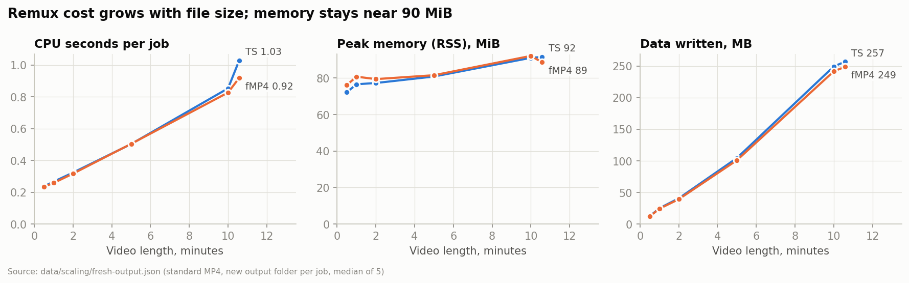
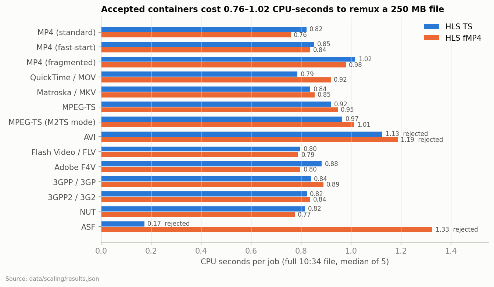
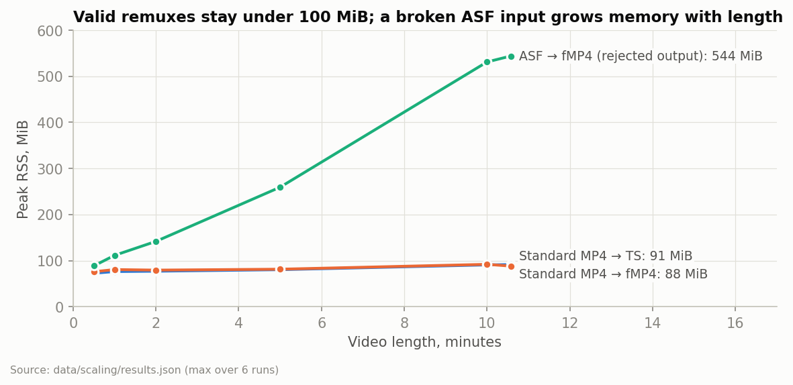
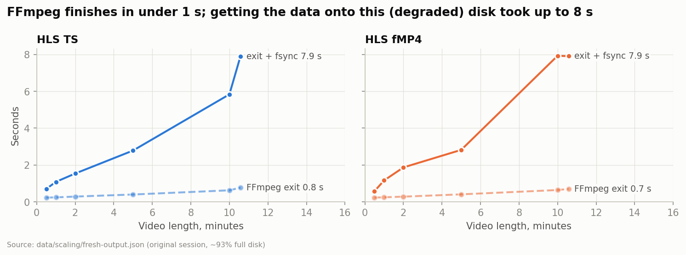
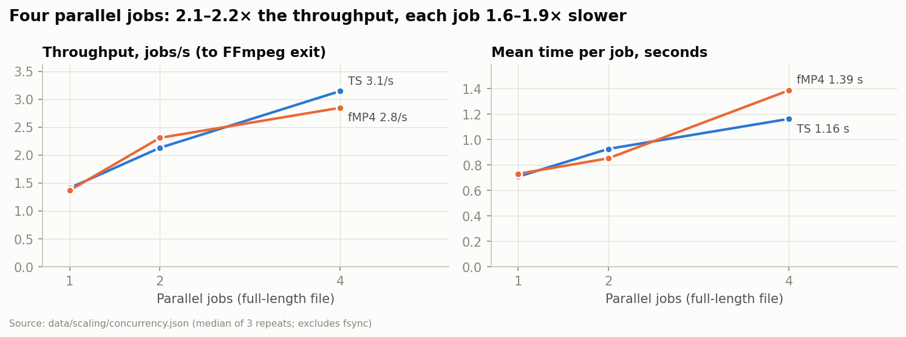
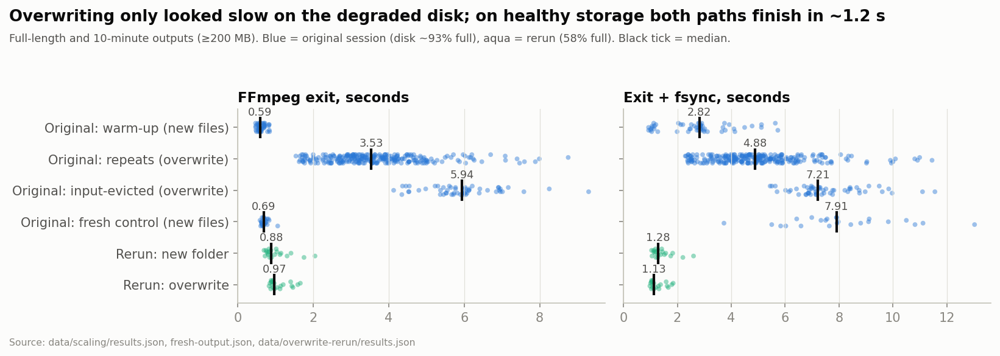

# Remux-first HLS for premium users: feasibility report

**Question.** The normal pipeline encodes a full ladder (240p–1080p, HLS TS) before a video can be watched. Can a separate *remux server* make an upload watchable within seconds, by repackaging the original H.264/AAC stream into HLS without re-encoding, for premium users while the ladder encodes in the background?

**Short answer: yes, for H.264/AAC uploads in common containers, with an input gate and an output check.** Remuxing a 10-minute 1080p file (~250 MB) costs about **1 CPU-second and under 100 MiB of RAM**, and finished, fsynced, in **~1.1–1.3 s** on healthy local storage. Output was bit-exact for 12 of 14 container types. Time-to-watch for premium users will mostly be **download + upload time**, not remuxing. The risks are in the inputs: wrong codecs, AVI/ASF timestamps, long keyframe intervals and high bitrates. None of these is a CPU problem.

Measured 15–16 October 2026 on one laptop with one film (Big Buck Bunny 1080p30, H.264 High@4.1 with B-frames, AAC-LC). FFmpeg 8.1.3. Sections 1–8 are measured; section 9 adds production concerns this test did not cover, clearly marked.

---

## Contents

1. [What was tested](#1-what-was-tested)
2. [Correctness: which uploads can be remuxed](#2-correctness-which-uploads-can-be-remuxed)
3. [Segment structure: you get the source's keyframes](#3-segment-structure-you-get-the-sources-keyframes)
4. [Resource cost per job](#4-resource-cost-per-job)
5. [Time to finish: remux vs storage](#5-time-to-finish-remux-vs-storage)
6. [Concurrency](#6-concurrency)
7. [Why the original wall-clock times were misleading](#7-why-the-original-wall-clock-times-were-misleading)
8. [Sizing a remux server](#8-sizing-a-remux-server)
9. [Production design: gates and risks not covered by the test](#9-production-design-gates-and-risks-not-covered-by-the-test)
10. [Data quality and limits](#10-data-quality-and-limits)
11. [Appendix A: all 168 cases](#appendix-a-all-168-cases)
12. [Appendix B: files, data dictionary, reproduction](#appendix-b-files-data-dictionary-reproduction)

---

## 1. What was tested

| Item | Detail |
|---|---|
| Source | Big Buck Bunny (Sunflower), 1920×1080 progressive, 30 fps, H.264 High Level 4.1, 8-bit 4:2:0, **B-frames**. 276,134,947 bytes, SHA-256 `ae51005850b0ff757fe60c3dd7a12d754d3cd2397d87d939b55235e457f97658`. |
| Audio | Original MP3/AC-3 converted **once** to AAC-LC 128 kb/s stereo 48 kHz while preparing fixtures. Audio conversion is **not** in any timing. |
| Lengths | 30 s, 1, 2, 5, 10 min and full 10:34.6, all cut from the start (inputs 11.9–248.9 MB). Note that 10 min and full differ by only 3% in size. |
| Input containers | 14: MP4 (standard / fast-start / fragmented), MOV, MKV, MPEG-TS, M2TS, AVI, FLV, F4V, 3GP, 3G2, NUT, ASF. Same encoded streams in each. |
| Outputs | HLS VOD with MPEG-TS segments, and HLS with fragmented-MP4 segments. `-hls_time 6`, `independent_segments`, `-c copy` (plus `aac_adtstoasc` for fMP4). One rendition; no ladder. |
| Command | `ffmpeg -i IN -map 0:v:0 -map 0:a:0 -c copy -f hls -hls_time 6 -hls_playlist_type vod -hls_list_size 0 -hls_flags independent_segments -hls_segment_type mpegts …` (exact argv per case in `data/scaling/results.json`) |
| Machine | AMD Ryzen 5 PRO 5650U (6 cores / 12 threads), 30.7 GiB RAM, NVMe SSD, Btrfs, Fedora (Linux 7.2.10), `powersave` governor, normal desktop running. |
| Experiments | **E1** 30-second baseline with frame-level decode checks (28 paths). **E2** scaling matrix: 6 lengths × 14 containers × 2 outputs = 168 cases, 5 warm + 1 input-evicted run each (1,008 runs + 168 warm-ups). **E3** fresh-output control: new folder per job, standard MP4, 72 runs. **E4** concurrency: 1/2/4 parallel jobs × 3 repeats. **E5** AVI/ASF via an MP4 intermediate (8 routes). **E6** paired rerun, new vs overwritten output folders, healthy disk (40 runs). |
| Measurement | `scripts/scaling/measure.py`: fork/exec + `wait4` gives exact CPU seconds and peak RSS of the FFmpeg process; `/proc` I/O counters; then a separate, timed fsync of every output file and the folder. |

---

## 2. Correctness: which uploads can be remuxed

A path was **accepted** only if all of these held:

1. The compressed video (H.264 VCL NAL units and SPS/PPS) and audio (AAC frames) are byte-identical to the reference.
2. Every packet's presentation time is within 2 ms of the reference, DTS strictly increase, and the audio/video start offset is preserved.
3. Every segment decodes on its own with strict error checking and starts on a keyframe. 1,337 unique segments were decoded.
4. The playlist is valid: VOD, endlist, target duration correct, all files present.
5. Chromium + hls.js plays it: start, mid seek, near-end seek, play to end, no errors.

<!-- gen:compat -->
| Input container / layout | HLS TS (6 lengths) | HLS fMP4 (6 lengths) | Rejection reason |
|---|---|---|---|
| MP4 (standard) | ✅ 6/6 | ✅ 6/6 | — |
| MP4 (fast-start) | ✅ 6/6 | ✅ 6/6 | — |
| MP4 (fragmented) | ✅ 6/6 | ✅ 6/6 | — |
| QuickTime / MOV | ✅ 6/6 | ✅ 6/6 | — |
| Matroska / MKV | ✅ 6/6 | ✅ 6/6 | — |
| MPEG-TS | ✅ 6/6 | ✅ 6/6 | — |
| MPEG-TS (M2TS mode) | ✅ 6/6 | ✅ 6/6 | — |
| AVI | ❌ 0/6 | ❌ 0/6 | timestamps / audio-video alignment |
| Flash Video / FLV | ✅ 6/6 | ✅ 6/6 | — |
| Adobe F4V | ✅ 6/6 | ✅ 6/6 | — |
| 3GPP / 3GP | ✅ 6/6 | ✅ 6/6 | — |
| 3GPP2 / 3G2 | ✅ 6/6 | ✅ 6/6 | — |
| NUT | ✅ 6/6 | ✅ 6/6 | — |
| ASF | ❌ 0/6 | ❌ 0/6 | FFmpeg muxing failed; target_duration_valid, timestamps / audio-video alignment |

**144/168 paths accepted.**
<!-- /gen -->

<!-- gen:browser -->
144/144 accepted outputs passed the browser check (Chromium 156.0.8078.4, hls.js 1.6.13): startup, mid seek, near-end seek, play to end, no player/media errors.
<!-- /gen -->

<!-- gen:baseline -->
24/28 30-second outputs decoded to frames and PCM audio identical to the reference (900/900 frames each), checked with per-frame MD5 (`data/baseline-30s/framemd5/`).
<!-- /gen -->

**MP4, MOV, MKV, TS/M2TS, FLV, F4V, 3GP/3G2 and NUT remux perfectly to both TS and fMP4 HLS at every length.** These cover the bulk of real uploads: phones and cameras produce MP4/MOV, and screen and stream recorders produce MKV/TS/MP4.

### The two failures, and why they matter for a remux server

Full-length evidence:

<!-- gen:failures -->
| Input | Output | FFmpeg exit 0 | Compressed payload identical | Playlist s | Target duration | Max video PTS error ms | Video−audio start ms | Rejected for |
|---|---|---|---|---|---|---|---|---|
| AVI | TS | yes | video ✓ audio ✓ | 627.4 | 12 | 64.7 | 55 (ref 88) | timestamps / audio-video alignment |
| AVI | fMP4 | yes | video ✓ audio ✓ | 627.4 | 12 | 64.7 | 55 (ref 88) | timestamps / audio-video alignment |
| ASF | TS | no | not produced | — | — | — | — | FFmpeg muxing failed |
| ASF | fMP4 | yes | video ✓ audio ✓ | 0.0 | 0 | 67.0 | 21 (ref 88) | target_duration_valid, timestamps / audio-video alignment |
<!-- /gen -->

- **AVI:** FFmpeg exits cleanly and the browser plays it to the end, but video timestamps are off by up to 65 ms, about 2 frames. On a B-frame stream that can mean frames shown in the wrong order (judder), not just an A/V offset. AVI cannot carry B-frame timing properly; `-fflags +genpts` does not fix it.
- **ASF → TS:** FFmpeg refuses ("first pts and dts value must be set"), so no output is produced.
- **ASF → fMP4:** the most dangerous case. FFmpeg **exits 0**, writes one segment with a **0-second playlist** and `EXT-X-TARGETDURATION:0`, and its memory grows with file length to 544 MiB (section 4). Exit code alone would have published a broken asset.

Going via an MP4 intermediate (E5) does not rescue them. All eight routes still fail timing:

<!-- gen:via_mp4 -->
| Length | Input | Timestamps | MP4 exit | HLS exit | Max PTS error ms | Video−audio start ms | DTS increasing | Accepted |
|---|---|---|---|---|---|---|---|---|
| 30 s | AVI | default | 0 | 0 | 99.7 | 0 | False | no |
| 30 s | AVI | genpts | 0 | 0 | 98.0 | 55 | True | no |
| 30 s | ASF | default | 0 | 0 | 100.0 | 21 | False | no |
| 30 s | ASF | genpts | 0 | 0 | 67.0 | 55 | True | no |
| Full (10:34.6) | AVI | default | 0 | 0 | 88.0 | 0 | False | no |
| Full (10:34.6) | AVI | genpts | 0 | 0 | 64.7 | 55 | True | no |
| Full (10:34.6) | ASF | default | 0 | 0 | 67.0 | 21 | False | no |
| Full (10:34.6) | ASF | genpts | 0 | 0 | 34.0 | 55 | True | no |
<!-- /gen -->

**Take-away:** route AVI/ASF/WMV uploads straight to the encoding ladder (re-encoding fixes timestamps) and never try to remux them. Never treat FFmpeg exit code 0 as success; check the playlist (section 9).

Caveat: the AVI/ASF fixtures were made by FFmpeg from the MP4. "These fixtures fail" is proven; "every real AVI fails" is likely for B-frame H.264, but was not tested.

---

## 3. Segment structure: you get the source's keyframes

Stream copy can only cut segments at **keyframes that already exist** in the upload. `-hls_time 6` is a target, not a guarantee. Standard MP4 → TS:

<!-- gen:segments -->
| Length | Segments | Shortest s | Median s | Longest s | EXT-X-TARGETDURATION | Segments > 6.5 s |
|---|---|---|---|---|---|---|
| 30 s | 5 | 2.60 | 7.30 | 8.33 | 8 | 3 |
| 1 min | 9 | 3.87 | 7.90 | 8.33 | 8 | 6 |
| 2 min | 19 | 3.13 | 6.13 | 11.43 | 11 | 9 |
| 5 min | 50 | 1.23 | 5.97 | 12.70 | 13 | 22 |
| 10 min | 95 | 1.23 | 6.57 | 12.70 | 13 | 50 |
| Full (10:34.6) | 99 | 1.23 | 6.90 | 12.70 | 13 | 55 |
<!-- /gen -->

Big Buck Bunny has irregular, scene-cut keyframes, so segments range from 1.2 to 12.7 s and the target duration reaches **13 s**. FFmpeg sets this correctly; RFC 8216 §4.3.3.1 requires every segment, rounded, to be ≤ `EXT-X-TARGETDURATION`. So the playlists are valid, but:

- Longer segments mean slower start-up and coarser seeking than your ladder's even segments. Apple's authoring guidance (as widely reported) targets 6-second segments with ~2-second keyframes.
- Uploads with very long keyframe intervals (screen recorders, some OBS/stream captures with 10–20 s GOPs) will produce very long segments.
- The remuxed rendition's segment boundaries will **not** line up with the ladder's, so it should not be mixed into the ladder's master playlist as a rung (section 9).

---

## 4. Resource cost per job

Numbers from the **fresh-output control** (E3): standard MP4 input, a new output folder per job like a real service, median of 5 warm runs.

<!-- gen:fresh -->
| Length | Output | Input MB | FFmpeg exit s | Exit + fsync s | CPU s | CPU % of 1 core | Peak RSS MiB | Storage write MB | Output byte-identical |
|---|---|---|---|---|---|---|---|---|---|
| 30 s | TS | 11.9 | 0.230 | 0.705 | 0.237 | 103 | 72.2 | 12.3 | yes |
| 30 s | fMP4 | 11.9 | 0.229 | 0.579 | 0.235 | 103 | 76.2 | 11.9 | yes |
| 1 min | TS | 24.2 | 0.243 | 1.085 | 0.266 | 109 | 76.6 | 24.9 | yes |
| 1 min | fMP4 | 24.2 | 0.248 | 1.163 | 0.258 | 106 | 80.7 | 24.1 | yes |
| 2 min | TS | 39.3 | 0.286 | 1.538 | 0.324 | 114 | 77.3 | 40.6 | yes |
| 2 min | fMP4 | 39.3 | 0.282 | 1.868 | 0.317 | 113 | 79.4 | 39.2 | yes |
| 5 min | TS | 101.0 | 0.398 | 2.784 | 0.503 | 126 | 80.8 | 104.4 | yes |
| 5 min | fMP4 | 101.0 | 0.407 | 2.821 | 0.504 | 122 | 81.6 | 101.0 | yes |
| 10 min | TS | 241.8 | 0.626 | 5.834 | 0.853 | 136 | 91.1 | 249.5 | yes |
| 10 min | fMP4 | 241.8 | 0.641 | 7.928 | 0.827 | 131 | 92.1 | 241.8 | yes |
| Full (10:34.6) | TS | 248.9 | 0.771 | 7.904 | 1.029 | 136 | 91.5 | 256.9 | yes |
| Full (10:34.6) | fMP4 | 248.9 | 0.698 | 7.909 | 0.919 | 132 | 88.6 | 248.8 | yes |
<!-- /gen -->

CPU grows linearly with the bytes copied, on top of a small fixed start-up cost:

<!-- gen:cpu_fit -->
- TS: `CPU_seconds ≈ 0.198 + 3.03 × input_GB` (six points, R² = 0.978): about **0.20 s fixed** per job plus **3.03 CPU-s per GB** of input.
- fMP4: `CPU_seconds ≈ 0.206 + 2.74 × input_GB` (six points, R² = 0.992): about **0.21 s fixed** per job plus **2.74 CPU-s per GB** of input.
<!-- /gen -->

- **CPU:** ~1 CPU-second for a 250 MB file. CPU use above 100% means FFmpeg used slightly more than one core (demux/mux threads). Remuxing is not CPU-heavy.
- **Memory:** 72–92 MiB peak for every valid job, almost flat with length. It is mostly the FFmpeg binary and libraries, not buffered video.
- **Disk:** writes ≈ input size (TS adds ~3% packet overhead; fMP4 ≈ input). Reads ≈ input size when not cached.

### Cost by upload container (full-length file)

<!-- gen:containers -->
| Input (full length) | TS CPU s | TS peak RSS MiB | fMP4 CPU s | fMP4 peak RSS MiB | Status |
|---|---|---|---|---|---|
| MP4 (standard) | 0.82 | 91 | 0.76 | 88 | accepted |
| MP4 (fast-start) | 0.85 | 92 | 0.84 | 89 | accepted |
| MP4 (fragmented) | 1.02 | 91 | 0.98 | 86 | accepted |
| QuickTime / MOV | 0.79 | 94 | 0.92 | 88 | accepted |
| Matroska / MKV | 0.84 | 85 | 0.85 | 85 | accepted |
| MPEG-TS | 0.92 | 85 | 0.95 | 86 | accepted |
| MPEG-TS (M2TS mode) | 0.97 | 85 | 1.01 | 86 | accepted |
| AVI | 1.13 | 87 | 1.19 | 86 | rejected |
| Flash Video / FLV | 0.80 | 84 | 0.79 | 87 | accepted |
| Adobe F4V | 0.88 | 91 | 0.80 | 88 | accepted |
| 3GPP / 3GP | 0.84 | 91 | 0.89 | 89 | accepted |
| 3GPP2 / 3G2 | 0.82 | 92 | 0.84 | 88 | accepted |
| NUT | 0.82 | 90 | 0.77 | 85 | accepted |
| ASF | 0.17 | 67 | 1.33 | 544 | rejected |
<!-- /gen -->

Fragmented MP4 and TS/M2TS inputs cost 12–29% more CPU than standard MP4 (more boxes/packets to parse); everything accepted stays within 0.76–1.02 CPU-s.

### Memory: the failure case is the risk

The broken ASF → fMP4 job grows memory with length (89 → 544 MiB). A per-job memory limit (e.g. 256 MiB) plus a timeout would contain it. Valid jobs need well under 100 MiB.

### Resource table, all lengths (standard MP4, main matrix)

CPU, RSS and byte counters in the main matrix are reliable (only its wall-clock times are not; see section 7).

<!-- gen:matrix_resources -->
| Length | Output | CPU s | Peak RSS MiB | Logical read MB | Logical write MB | Storage read MB (input evicted) | Storage write MB | Output files |
|---|---|---|---|---|---|---|---|---|
| 30 s | TS | 0.197 | 72.7 | 12.3 | 12.3 | 11.9 | 12.3 | 6 |
| 30 s | fMP4 | 0.212 | 75.9 | 12.3 | 11.9 | 11.9 | 11.9 | 7 |
| 1 min | TS | 0.251 | 76.3 | 24.5 | 24.9 | 24.2 | 24.9 | 10 |
| 1 min | fMP4 | 0.246 | 80.6 | 24.5 | 24.1 | 24.2 | 24.2 | 11 |
| 2 min | TS | 0.302 | 77.1 | 39.6 | 40.5 | 39.3 | 40.6 | 20 |
| 2 min | fMP4 | 0.316 | 79.4 | 39.6 | 39.2 | 39.3 | 39.3 | 21 |
| 5 min | TS | 0.494 | 80.4 | 101.4 | 104.3 | 101.0 | 104.4 | 51 |
| 5 min | fMP4 | 0.479 | 81.4 | 101.4 | 100.9 | 101.1 | 101.0 | 52 |
| 10 min | TS | 0.838 | 90.8 | 242.2 | 249.3 | 241.8 | 249.6 | 96 |
| 10 min | fMP4 | 0.799 | 92.0 | 242.2 | 241.5 | 242.0 | 241.8 | 97 |
| Full (10:34.6) | TS | 0.822 | 91.4 | 249.3 | 256.6 | 249.4 | 256.9 | 100 |
| Full (10:34.6) | fMP4 | 0.758 | 88.1 | 249.3 | 248.6 | 248.9 | 248.9 | 101 |
<!-- /gen -->

---

## 5. Time to finish: remux vs storage

"Done" can mean FFmpeg has exited (data may still be in RAM), or the files are durable (fsync; in production, *uploaded to object storage*). The two differ a lot:

In the original session the disk was ~93% full after ~100 GB of test writes. There, FFmpeg exited in **0.7–0.8 s** but making 250 MB durable took **~7.9 s**. On the same laptop with a healthy disk (E6), the whole job including fsync took **1.1–1.3 s**:

<!-- gen:rerun_env -->
Rerun: 2026-10-16 02:39:45 EEST, 99 GiB free on the 236 GiB btrfs volume, governor `powersave`, ffmpeg version 8.1.3.
<!-- /gen -->

<!-- gen:rerun -->
| Output | Metric | New folder (median) | Overwrite (median) | Paired difference (median) | Overwrite higher in |
|---|---|---|---|---|---|
| TS | FFmpeg exit s | 0.93 | 1.08 | +0.07 | 7/10 |
| TS | CPU s | 1.20 | 1.33 | +0.07 | 7/10 |
| TS | fsync s | 0.40 | 0.17 | -0.22 | 0/10 |
| TS | Exit + fsync s | 1.33 | 1.25 | -0.13 | 1/10 |
| fMP4 | FFmpeg exit s | 0.85 | 0.94 | +0.11 | 8/10 |
| fMP4 | CPU s | 1.06 | 1.15 | +0.12 | 8/10 |
| fMP4 | fsync s | 0.39 | 0.16 | -0.22 | 0/10 |
| fMP4 | Exit + fsync s | 1.28 | 1.10 | -0.11 | 4/10 |
<!-- /gen -->

**Storage condition dominates job time, not FFmpeg.** In production the equivalent of fsync is the upload of segments to object storage/CDN origin, which will cost more than the remux itself:

| Package (full file) | Size | Minimum upload at 100 Mb/s | at 1 Gb/s |
|---|---|---|---|
| HLS TS | 256.9 MB | 20.6 s | 2.1 s |
| HLS fMP4 | 248.8 MB | 19.9 s | 2.0 s |

These are arithmetic floors (size ÷ bandwidth) with no request overhead. Uploading 100 segments plus a playlist adds per-request latency. Not measured.

---

## 6. Concurrency

Full-length file, 1/2/4 jobs started together, 3 repeats each (median), on the original (degraded) disk:

<!-- gen:concurrency -->
| Output | Parallel jobs | Repeats | Batch exit s | Mean job exit s | Exit jobs/s | Aggregate CPU % | Sampled peak RSS MiB (sum) | Batch + fsync s | Jobs/s incl. fsync |
|---|---|---|---|---|---|---|---|---|---|
| TS | 1 | 3 | 0.71 | 0.71 | 1.41 | 136 | 90 | 6.6 | 0.15 |
| TS | 2 | 3 | 0.94 | 0.93 | 2.13 | 260 | 172 | 14.5 | 0.14 |
| TS | 4 | 3 | 1.27 | 1.16 | 3.15 | 446 | 338 | 27.5 | 0.15 |
| fMP4 | 1 | 3 | 0.73 | 0.73 | 1.37 | 130 | 89 | 7.8 | 0.13 |
| fMP4 | 2 | 3 | 0.87 | 0.85 | 2.31 | 256 | 177 | 13.9 | 0.14 |
| fMP4 | 4 | 3 | 1.40 | 1.39 | 2.85 | 418 | 354 | 17.5 | 0.23 |
<!-- /gen -->

- To FFmpeg exit, 4 parallel jobs give 2.1–2.2× the throughput of 1. Each job slows from ~0.7 s to 1.2–1.4 s as they compete for CPU, memory bandwidth and the disk.
- **Including fsync, throughput stayed at ~0.13–0.23 jobs/s whatever the parallelism**, because the degraded disk was the bottleneck. Adding workers does not help when storage is saturated. Size storage and network bandwidth first, workers second.
- Memory adds up linearly (~90 MiB per job).

Only 3 repeats per point: good for the shape, not for tail latency.

---

## 7. Why the original wall-clock times were misleading

The main matrix (E2) wrote each case's six runs into the **same output folder**, overwriting the previous run's files. Its wall-clock times (Appendix A, "Exit s") are 2–5× noisy and should not be used. The cause was identified and then tested:

<!-- gen:overwrite -->
| Runs (outputs ≥ 200 MB) | n | FFmpeg exit s | CPU s | fsync s | Exit + fsync s |
|---|---|---|---|---|---|
| Original: warm-up (new files) | 54 | 0.59 | 0.78 | 2.16 | 2.82 |
| Original: repeats (overwrite) | 270 | 3.53 | 0.87 | 1.17 | 4.88 |
| Original: input-evicted (overwrite) | 54 | 5.94 | 1.16 | 1.46 | 7.21 |
| Original: fresh control (new files) | 24 | 0.69 | 0.90 | 7.22 | 7.91 |
| Rerun: new folder | 20 | 0.88 | 1.13 | 0.40 | 1.28 |
| Rerun: overwrite | 20 | 0.97 | 1.18 | 0.17 | 1.13 |

Original session: the new-folder warm-up was faster than the same case's overwrite median in **54/54** cases.
<!-- /gen -->

- **Mechanism (confirmed).** When Btrfs truncates and rewrites an existing file, it starts writing the data out as the file is closed. That moves disk-write time *into* FFmpeg's run. New files stay in page cache until fsync. Dirty page cache sampled during rerun repeat 1:

<!-- gen:traces -->
| Output | Folder | Peak dirty page cache while FFmpeg runs, MiB |
|---|---|---|
| fMP4 | new | 239 |
| fMP4 | overwrite | 7 |
| TS | new | 233 |
| TS | overwrite | 9 |
<!-- /gen -->

- **Magnitude depended on the disk.** On the healthy disk, overwriting cost only ~0.1 s (matched by ~0.1 extra CPU-second: kernel work, not waiting). On the original, nearly full disk after ~100 GB of writes, the same writeback made overwrite runs take ~3.5 s. The rerun can't tell fullness apart from sustained-write effects.
- **Drift.** The original session also slowed steadily as the disk filled. CPU stayed flat while fsync time doubled:

<!-- gen:drift -->
| Warm round | Median FFmpeg exit s (accepted cases) | Median CPU s | Median fsync s |
|---|---|---|---|
| 1 | 0.652 | 0.409 | 0.375 |
| 2 | 0.835 | 0.377 | 0.482 |
| 3 | 0.944 | 0.366 | 0.671 |
| 4 | 1.171 | 0.453 | 0.740 |
| 5 | 1.208 | 0.456 | 0.738 |
<!-- /gen -->

**What this means for the service:** write each job's output to a **new path** (job ID). Measure completion as *upload acknowledged*, not FFmpeg exit. Re-measure on the real servers. Use CPU, RSS and byte counts from this study, not its wall-clock times.

---

## 8. Sizing a remux server

Demand calculations from measured per-job costs. These are planning estimates, **not** measured service capacity.

**Per job (one HLS TS output):**

| Resource | Formula (from section 4) | 10-min 1080p @ ~3.3 Mb/s (250 MB) | 10-min 1080p phone @ ~16 Mb/s (~1.2 GB, extrapolated) |
|---|---|---|---|
| CPU | ≈ 0.20 s + 3.0 CPU-s/GB | ~1.0 CPU-s | ~3.8 CPU-s |
| Memory | ≈ 90 MiB flat (cap at 256 MiB) | ~90 MiB | ~90–100 MiB |
| Local disk / network | read ≈ input, write ≈ input × 1.03 | 250 MB in, 257 MB out | 1.2 GB in, 1.24 GB out |
| Remux time, healthy local SSD | measured | ~1.2 s incl. fsync | not measured (expect several seconds) |

The phone column extrapolates the linear CPU fit beyond the measured 0.25 GB and is unverified.

**Capacity rule of thumb:**
`cores ≈ uploads_per_second × CPU_s_per_job ÷ target_utilisation`.
Example: 1,000 premium uploads/hour (0.28/s) of 250 MB at 60% target utilisation is 0.28 × 1.0 ÷ 0.6 ≈ **0.5 core**. **Bandwidth is the real constraint:** the same load moves ~140 MB/s in and out combined (0.28/s × ~500 MB), plus object-storage request rates of ~100 segment PUTs per video.

**Time-to-watch for a premium user** ≈ queue wait + download source + remux (~1–4 s) + upload segments + playlist publish. With the source already on the same network as object storage, the target of "watchable within ~10 s of upload completing" for a 10-min 1080p file looks achievable. Measure it end-to-end on real infrastructure.

**Producing TS only (your format) halves the work** compared with this study's TS + fMP4 pair. Producing both from one FFmpeg process (reading the input once) was not tested.

---

## 9. Production design: gates and risks not covered by the test

Everything in this section is **beyond what was measured**. It comes from the HLS specification, vendor guidance and general FFmpeg experience. Each item should be verified before launch.

### Input gate (decide in ~100 ms with `ffprobe` before remuxing)

| Check | Remux if | Otherwise | Why |
|---|---|---|---|
| Video codec | H.264 | Ladder only | TS-segment HLS is H.264 territory. HEVC needs fMP4 segments and plays only on some devices/browsers. VP9/AV1/ProRes cannot go into TS. |
| H.264 profile/level | ≤ High, level ≤ 4.2 | Ladder only | Apple's authoring spec limit (as reported by secondary sources; verify against Apple's current spec). 4:2:2/10-bit "High 10/4:2:2" won't play in browsers. |
| Container | MP4, MOV, MKV, TS, M2TS, FLV, F4V, 3GP, 3G2 | AVI, ASF/WMV, unknown: ladder only | Section 2. |
| Audio codec | AAC | Re-encode audio only (cheap), or ladder | Audio re-encoding cost was not measured here; the test pre-converted audio. |
| Keyframe interval | max gap ≤ ~10 s | Ladder only | Section 3. Long gaps mean very long segments, slow start and seek. |
| Bitrate / resolution | e.g. ≤ 1080p and ≤ ~10–15 Mb/s | Ladder only, or warn | There is no adaptive bitrate. A 4K60 or 40 Mb/s phone file streams at full source bitrate and will buffer on mobile. |
| Rotation metadata | none | Test first | Phone portrait videos rely on a display-matrix tag. TS-segment HLS has no equivalent, so remuxed playback may appear **sideways**. **High-priority test** before launch with real iPhone/Android uploads. |
| Variable frame rate | constant | Usually fine; test | Phone VFR is normally preserved by stream copy, but was not tested here. |

### Output check (cheap version of this study's validation)

The full validation in this study (payload hashes, per-segment decoding) took ~30 minutes for 168 cases, far too heavy for a request path. A cheap check that catches every failure seen here:

1. FFmpeg exit 0 **and** playlist has `#EXT-X-ENDLIST`, `EXT-X-TARGETDURATION` > 0, at least one segment, all segment files present and non-empty.
2. Sum of `#EXTINF` within ~1 s of the probed input duration. This catches ASF → fMP4's 0-second playlist.
3. Max `#EXTINF` within the gate's limit (section 3).
4. Optional: `ffprobe` the first and last segment for decodability.

Per-job limits: memory ~256 MiB, timeout proportional to input size. A job that fails any check falls back to the ladder only, and the premium user waits like everyone else.

### Switching to the ladder when it is ready

- Serve the remux as its own **single-rendition** playlist (`…/remux/playlist.m3u8`). When the ladder finishes, switch the video's playback URL to the ladder's master playlist, an atomic database/config change.
- **Do not add the remuxed rendition to the ladder's master playlist as a rung.** Its segment boundaries follow the source keyframes and won't align with the ladder's forced keyframes, so switching between them mid-play breaks or stalls.
- Players that already loaded the remux playlist keep using it until they reload. Keep remux segments for a grace period (hours), then delete them.
- Set short CDN cache lifetimes on the playlist URL that changes, or use versioned URLs.

### Other operational notes

- Write to a new path per job (section 7); never overwrite live segments.
- Make "ready" mean playlist uploaded after all segments, so players never see a playlist that references missing files.
- Sources from HTTP: progressive download vs range reads, and fast-start vs moov-at-end MP4 over the network, were **not** measured. Inputs here were local files.

---

## 10. Data quality and limits

**Strong:** the correctness evidence (bit-exact payloads, 2 ms timing, per-segment decoding, browser checks; plus frame-level decode identity in the 30 s baseline). Exact CPU/RSS accounting. Exact commands, source checksum, FFmpeg build and seeded run order retained. Rerun outputs were byte-identical to the original study's.

**Weak or limited:**

- **One film, one laptop.** Container conclusions generalise well; absolute numbers do not. Real uploads have different bitrates, GOPs, codecs and metadata.
- **Main-matrix wall-clock times are not usable** (section 7). Fresh-control and rerun times are.
- **Storage state changed during the session** (42 → ~16 GiB free, ~100 GB written). Fsync and concurrency-with-fsync numbers describe that degraded disk.
- **CPU seconds differ between sessions:** 0.8–0.9 s originally vs 1.0–1.3 s in the rerun, for byte-identical work. Cause unknown (CPU frequency under `powersave`, background load). Compare CPU within one session; plan with ~1.0–1.3 CPU-s per 250 MB.
- **Small samples:** 5 warm runs per case, 3 per concurrency point, 10 pairs in the rerun. Medians are fine; no p95/p99.
- **Desktop, not server:** `powersave` governor, other apps running. Btrfs only (ext4/XFS writeback behaviour on overwrite differs in detail).
- **Not covered:** network/object storage, HEVC/VP9/AV1, other resolutions/frame rates, rotation, VFR, damaged files, Safari/iOS native playback, audio transcoding cost, multi-output jobs, cgroup limits.

### Review history

The original Codex reports led with the main-matrix wall times and fitted regressions to them. A first review (15 Oct) attributed their noise to the filling disk. A second look (16 Oct) found the overwrite pattern. A paired rerun (E6) showed both were needed: the overwrite mechanism plus slow storage. This report supersedes all earlier reports; they remain in git history (commit `5ddbc60` and earlier).

---

## Appendix A: all 168 cases

CPU, RSS and write volumes are reliable. **"Exit s" is from the overwrite matrix and is not a usable latency** (section 7); it is kept for completeness.

<!-- gen:matrix -->
| Length | Input | Output | Input MB | CPU s | Peak RSS MiB | Storage write MB | Exit s (overwrite, see §7) | Exit range s | Result | Finding |
|---|---|---|---|---|---|---|---|---|---|---|
| 30 s | MP4 (standard) | TS | 11.9 | 0.197 | 72.7 | 12.3 | 0.192 | 0.18–0.21 | PASS | PASS |
| 30 s | MP4 (standard) | fMP4 | 11.9 | 0.212 | 75.9 | 11.9 | 0.242 | 0.18–0.43 | PASS | PASS |
| 30 s | MP4 (fast-start) | TS | 11.9 | 0.200 | 72.6 | 12.3 | 0.194 | 0.19–0.21 | PASS | PASS |
| 30 s | MP4 (fast-start) | fMP4 | 11.9 | 0.207 | 76.1 | 11.9 | 0.199 | 0.19–0.32 | PASS | PASS |
| 30 s | MP4 (fragmented) | TS | 11.9 | 0.210 | 72.5 | 12.3 | 0.199 | 0.19–0.21 | PASS | PASS |
| 30 s | MP4 (fragmented) | fMP4 | 11.9 | 0.231 | 76.0 | 11.9 | 0.221 | 0.20–0.23 | PASS | PASS |
| 30 s | QuickTime / MOV | TS | 11.9 | 0.205 | 72.4 | 12.3 | 0.200 | 0.17–0.21 | PASS | PASS |
| 30 s | QuickTime / MOV | fMP4 | 11.9 | 0.210 | 76.3 | 11.9 | 0.203 | 0.18–0.29 | PASS | PASS |
| 30 s | Matroska / MKV | TS | 11.9 | 0.201 | 72.2 | 12.3 | 0.194 | 0.18–0.28 | PASS | PASS |
| 30 s | Matroska / MKV | fMP4 | 11.9 | 0.217 | 76.0 | 11.9 | 0.219 | 0.19–0.36 | PASS | PASS |
| 30 s | MPEG-TS | TS | 12.4 | 0.210 | 72.9 | 12.3 | 0.268 | 0.20–0.29 | PASS | PASS |
| 30 s | MPEG-TS | fMP4 | 12.4 | 0.223 | 79.5 | 11.9 | 0.212 | 0.20–0.26 | PASS | PASS |
| 30 s | MPEG-TS (M2TS mode) | TS | 12.7 | 0.228 | 73.1 | 12.3 | 0.226 | 0.18–0.31 | PASS | PASS |
| 30 s | MPEG-TS (M2TS mode) | fMP4 | 12.7 | 0.220 | 79.2 | 11.9 | 0.218 | 0.19–0.25 | PASS | PASS |
| 30 s | AVI | TS | 12.4 | 0.199 | 72.6 | 12.3 | 0.191 | 0.18–0.22 | FAIL | timestamps / audio-video alignment |
| 30 s | AVI | fMP4 | 12.4 | 0.218 | 76.0 | 11.9 | 0.231 | 0.20–0.30 | FAIL | timestamps / audio-video alignment |
| 30 s | Flash Video / FLV | TS | 11.9 | 0.204 | 72.4 | 12.3 | 0.196 | 0.17–0.29 | PASS | PASS |
| 30 s | Flash Video / FLV | fMP4 | 11.9 | 0.207 | 77.8 | 11.9 | 0.202 | 0.19–0.34 | PASS | PASS |
| 30 s | Adobe F4V | TS | 11.9 | 0.203 | 72.2 | 12.3 | 0.203 | 0.19–0.27 | PASS | PASS |
| 30 s | Adobe F4V | fMP4 | 11.9 | 0.215 | 76.1 | 12.0 | 0.210 | 0.19–0.67 | PASS | PASS |
| 30 s | 3GPP / 3GP | TS | 11.9 | 0.202 | 72.1 | 12.3 | 0.221 | 0.19–0.30 | PASS | PASS |
| 30 s | 3GPP / 3GP | fMP4 | 11.9 | 0.209 | 76.0 | 12.0 | 0.214 | 0.19–0.29 | PASS | PASS |
| 30 s | 3GPP2 / 3G2 | TS | 11.9 | 0.201 | 72.3 | 12.3 | 0.219 | 0.18–0.36 | PASS | PASS |
| 30 s | 3GPP2 / 3G2 | fMP4 | 11.9 | 0.205 | 76.2 | 12.0 | 0.199 | 0.18–0.30 | PASS | PASS |
| 30 s | NUT | TS | 11.9 | 0.212 | 71.4 | 12.3 | 0.214 | 0.20–0.34 | PASS | PASS |
| 30 s | NUT | fMP4 | 11.9 | 0.200 | 74.7 | 11.9 | 0.205 | 0.18–0.25 | PASS | PASS |
| 30 s | ASF | TS | 12.1 | 0.159 | 66.7 | 0.0 | 0.161 | 0.15–0.21 | FAIL | FFmpeg muxing failed |
| 30 s | ASF | fMP4 | 12.1 | 0.228 | 88.7 | 11.9 | 0.230 | 0.20–0.41 | FAIL | target_duration_valid, timestamps / audio-video alignment |
| 1 min | MP4 (standard) | TS | 24.2 | 0.251 | 76.3 | 24.9 | 0.277 | 0.22–0.99 | PASS | PASS |
| 1 min | MP4 (standard) | fMP4 | 24.2 | 0.246 | 80.6 | 24.2 | 0.231 | 0.23–0.45 | PASS | PASS |
| 1 min | MP4 (fast-start) | TS | 24.2 | 0.252 | 76.1 | 24.9 | 0.240 | 0.20–0.35 | PASS | PASS |
| 1 min | MP4 (fast-start) | fMP4 | 24.2 | 0.249 | 80.3 | 24.2 | 0.241 | 0.20–0.55 | PASS | PASS |
| 1 min | MP4 (fragmented) | TS | 24.1 | 0.265 | 76.8 | 24.9 | 0.379 | 0.24–0.47 | PASS | PASS |
| 1 min | MP4 (fragmented) | fMP4 | 24.1 | 0.257 | 80.7 | 24.2 | 0.297 | 0.25–0.43 | PASS | PASS |
| 1 min | QuickTime / MOV | TS | 24.2 | 0.251 | 76.5 | 24.9 | 0.232 | 0.22–0.27 | PASS | PASS |
| 1 min | QuickTime / MOV | fMP4 | 24.2 | 0.245 | 80.7 | 24.2 | 0.269 | 0.23–0.46 | PASS | PASS |
| 1 min | Matroska / MKV | TS | 24.1 | 0.240 | 77.0 | 25.0 | 0.221 | 0.22–0.27 | PASS | PASS |
| 1 min | Matroska / MKV | fMP4 | 24.1 | 0.263 | 80.0 | 24.2 | 0.258 | 0.23–0.48 | PASS | PASS |
| 1 min | MPEG-TS | TS | 25.1 | 0.292 | 77.0 | 24.9 | 0.305 | 0.23–0.59 | PASS | PASS |
| 1 min | MPEG-TS | fMP4 | 25.1 | 0.282 | 81.2 | 24.2 | 0.264 | 0.26–0.49 | PASS | PASS |
| 1 min | MPEG-TS (M2TS mode) | TS | 25.7 | 0.255 | 77.1 | 24.9 | 0.241 | 0.23–0.52 | PASS | PASS |
| 1 min | MPEG-TS (M2TS mode) | fMP4 | 25.7 | 0.298 | 81.4 | 24.2 | 0.280 | 0.24–0.33 | PASS | PASS |
| 1 min | AVI | TS | 25.0 | 0.277 | 76.1 | 25.0 | 0.345 | 0.23–0.63 | FAIL | timestamps / audio-video alignment |
| 1 min | AVI | fMP4 | 25.0 | 0.295 | 80.6 | 24.2 | 0.299 | 0.24–0.48 | FAIL | timestamps / audio-video alignment |
| 1 min | Flash Video / FLV | TS | 24.2 | 0.247 | 76.3 | 24.9 | 0.230 | 0.21–0.28 | PASS | PASS |
| 1 min | Flash Video / FLV | fMP4 | 24.2 | 0.258 | 81.5 | 24.2 | 0.250 | 0.22–0.29 | PASS | PASS |
| 1 min | Adobe F4V | TS | 24.2 | 0.240 | 76.1 | 24.9 | 0.278 | 0.22–0.51 | PASS | PASS |
| 1 min | Adobe F4V | fMP4 | 24.2 | 0.239 | 80.5 | 24.2 | 0.293 | 0.22–0.49 | PASS | PASS |
| 1 min | 3GPP / 3GP | TS | 24.2 | 0.242 | 76.3 | 25.0 | 0.464 | 0.22–0.62 | PASS | PASS |
| 1 min | 3GPP / 3GP | fMP4 | 24.2 | 0.239 | 80.4 | 24.2 | 0.307 | 0.23–0.47 | PASS | PASS |
| 1 min | 3GPP2 / 3G2 | TS | 24.2 | 0.233 | 76.4 | 24.9 | 0.226 | 0.20–0.54 | PASS | PASS |
| 1 min | 3GPP2 / 3G2 | fMP4 | 24.2 | 0.256 | 80.4 | 24.2 | 0.267 | 0.22–0.66 | PASS | PASS |
| 1 min | NUT | TS | 24.1 | 0.250 | 75.9 | 25.0 | 0.370 | 0.23–0.83 | PASS | PASS |
| 1 min | NUT | fMP4 | 24.1 | 0.251 | 79.7 | 24.2 | 0.247 | 0.22–0.50 | PASS | PASS |
| 1 min | ASF | TS | 24.4 | 0.159 | 66.9 | 0.0 | 0.161 | 0.15–0.18 | FAIL | FFmpeg muxing failed |
| 1 min | ASF | fMP4 | 24.4 | 0.274 | 111.4 | 24.2 | 0.288 | 0.23–0.34 | FAIL | target_duration_valid, timestamps / audio-video alignment |
| 2 min | MP4 (standard) | TS | 39.3 | 0.302 | 77.1 | 40.6 | 0.521 | 0.28–0.80 | PASS | PASS |
| 2 min | MP4 (standard) | fMP4 | 39.3 | 0.316 | 79.4 | 39.3 | 0.604 | 0.28–0.71 | PASS | PASS |
| 2 min | MP4 (fast-start) | TS | 39.3 | 0.296 | 77.1 | 40.6 | 0.439 | 0.26–0.70 | PASS | PASS |
| 2 min | MP4 (fast-start) | fMP4 | 39.3 | 0.310 | 79.9 | 39.3 | 0.789 | 0.56–1.00 | PASS | PASS |
| 2 min | MP4 (fragmented) | TS | 39.2 | 0.307 | 77.6 | 40.6 | 0.615 | 0.49–1.26 | PASS | PASS |
| 2 min | MP4 (fragmented) | fMP4 | 39.2 | 0.335 | 79.6 | 39.3 | 0.739 | 0.31–1.11 | PASS | PASS |
| 2 min | QuickTime / MOV | TS | 39.3 | 0.325 | 76.9 | 40.6 | 0.499 | 0.26–0.85 | PASS | PASS |
| 2 min | QuickTime / MOV | fMP4 | 39.3 | 0.290 | 79.2 | 39.2 | 0.542 | 0.24–0.80 | PASS | PASS |
| 2 min | Matroska / MKV | TS | 39.2 | 0.298 | 77.0 | 40.6 | 0.642 | 0.24–0.72 | PASS | PASS |
| 2 min | Matroska / MKV | fMP4 | 39.2 | 0.295 | 79.5 | 39.3 | 0.543 | 0.42–0.89 | PASS | PASS |
| 2 min | MPEG-TS | TS | 41.0 | 0.320 | 78.4 | 40.6 | 0.433 | 0.26–0.74 | PASS | PASS |
| 2 min | MPEG-TS | fMP4 | 41.0 | 0.346 | 80.0 | 39.3 | 0.425 | 0.26–0.83 | PASS | PASS |
| 2 min | MPEG-TS (M2TS mode) | TS | 41.9 | 0.326 | 78.2 | 40.6 | 0.599 | 0.45–0.98 | PASS | PASS |
| 2 min | MPEG-TS (M2TS mode) | fMP4 | 41.9 | 0.332 | 80.1 | 39.3 | 0.361 | 0.29–0.95 | PASS | PASS |
| 2 min | AVI | TS | 41.0 | 0.358 | 76.9 | 40.6 | 0.494 | 0.30–0.80 | FAIL | timestamps / audio-video alignment |
| 2 min | AVI | fMP4 | 41.0 | 0.355 | 79.2 | 39.3 | 0.779 | 0.30–0.94 | FAIL | timestamps / audio-video alignment |
| 2 min | Flash Video / FLV | TS | 39.3 | 0.315 | 76.8 | 40.6 | 0.495 | 0.27–1.03 | PASS | PASS |
| 2 min | Flash Video / FLV | fMP4 | 39.3 | 0.329 | 80.8 | 39.3 | 0.588 | 0.48–1.04 | PASS | PASS |
| 2 min | Adobe F4V | TS | 39.3 | 0.300 | 77.3 | 40.6 | 0.340 | 0.26–0.53 | PASS | PASS |
| 2 min | Adobe F4V | fMP4 | 39.3 | 0.320 | 79.6 | 39.2 | 0.765 | 0.43–0.90 | PASS | PASS |
| 2 min | 3GPP / 3GP | TS | 39.3 | 0.293 | 77.2 | 40.6 | 0.491 | 0.24–1.44 | PASS | PASS |
| 2 min | 3GPP / 3GP | fMP4 | 39.3 | 0.298 | 79.4 | 39.3 | 0.526 | 0.24–0.81 | PASS | PASS |
| 2 min | 3GPP2 / 3G2 | TS | 39.3 | 0.317 | 77.2 | 40.6 | 0.705 | 0.48–1.94 | PASS | PASS |
| 2 min | 3GPP2 / 3G2 | fMP4 | 39.3 | 0.308 | 79.5 | 39.3 | 0.435 | 0.32–0.86 | PASS | PASS |
| 2 min | NUT | TS | 39.2 | 0.290 | 76.3 | 40.6 | 0.560 | 0.26–0.77 | PASS | PASS |
| 2 min | NUT | fMP4 | 39.2 | 0.285 | 78.3 | 39.2 | 0.489 | 0.25–0.88 | PASS | PASS |
| 2 min | ASF | TS | 39.7 | 0.165 | 66.9 | 0.0 | 0.167 | 0.15–0.21 | FAIL | FFmpeg muxing failed |
| 2 min | ASF | fMP4 | 39.7 | 0.360 | 141.8 | 39.2 | 0.352 | 0.27–0.74 | FAIL | target_duration_valid, timestamps / audio-video alignment |
| 5 min | MP4 (standard) | TS | 101.0 | 0.494 | 80.4 | 104.4 | 1.336 | 0.85–3.10 | PASS | PASS |
| 5 min | MP4 (standard) | fMP4 | 101.0 | 0.479 | 81.4 | 101.0 | 1.231 | 0.89–2.53 | PASS | PASS |
| 5 min | MP4 (fast-start) | TS | 101.0 | 0.461 | 79.9 | 104.4 | 1.623 | 0.87–2.93 | PASS | PASS |
| 5 min | MP4 (fast-start) | fMP4 | 101.0 | 0.467 | 81.5 | 101.0 | 1.498 | 0.67–1.69 | PASS | PASS |
| 5 min | MP4 (fragmented) | TS | 100.8 | 0.546 | 81.6 | 104.5 | 1.258 | 0.71–2.64 | PASS | PASS |
| 5 min | MP4 (fragmented) | fMP4 | 100.8 | 0.558 | 81.8 | 101.0 | 1.539 | 0.92–2.18 | PASS | PASS |
| 5 min | QuickTime / MOV | TS | 101.0 | 0.491 | 79.8 | 104.4 | 1.458 | 0.87–2.27 | PASS | PASS |
| 5 min | QuickTime / MOV | fMP4 | 101.0 | 0.470 | 81.7 | 101.0 | 1.498 | 1.12–1.72 | PASS | PASS |
| 5 min | Matroska / MKV | TS | 100.9 | 0.494 | 82.0 | 104.4 | 1.242 | 0.81–3.69 | PASS | PASS |
| 5 min | Matroska / MKV | fMP4 | 100.9 | 0.485 | 81.7 | 101.1 | 1.821 | 0.76–2.91 | PASS | PASS |
| 5 min | MPEG-TS | TS | 105.5 | 0.528 | 81.3 | 104.4 | 1.647 | 0.91–2.30 | PASS | PASS |
| 5 min | MPEG-TS | fMP4 | 105.5 | 0.563 | 82.9 | 101.0 | 1.645 | 1.11–2.57 | PASS | PASS |
| 5 min | MPEG-TS (M2TS mode) | TS | 107.7 | 0.499 | 80.8 | 104.4 | 0.983 | 0.54–2.18 | PASS | PASS |
| 5 min | MPEG-TS (M2TS mode) | fMP4 | 107.7 | 0.531 | 82.8 | 101.0 | 1.795 | 0.90–1.96 | PASS | PASS |
| 5 min | AVI | TS | 105.4 | 0.638 | 79.6 | 104.4 | 1.430 | 0.91–2.65 | FAIL | timestamps / audio-video alignment |
| 5 min | AVI | fMP4 | 105.4 | 0.615 | 81.3 | 101.1 | 1.316 | 0.88–1.68 | FAIL | timestamps / audio-video alignment |
| 5 min | Flash Video / FLV | TS | 101.1 | 0.460 | 80.4 | 104.4 | 1.340 | 1.16–2.40 | PASS | PASS |
| 5 min | Flash Video / FLV | fMP4 | 101.1 | 0.495 | 82.4 | 101.1 | 2.171 | 1.05–3.20 | PASS | PASS |
| 5 min | Adobe F4V | TS | 101.0 | 0.501 | 80.0 | 104.4 | 1.735 | 1.00–2.03 | PASS | PASS |
| 5 min | Adobe F4V | fMP4 | 101.0 | 0.449 | 82.0 | 101.0 | 1.393 | 0.81–3.27 | PASS | PASS |
| 5 min | 3GPP / 3GP | TS | 101.0 | 0.468 | 80.3 | 104.4 | 1.089 | 0.96–1.87 | PASS | PASS |
| 5 min | 3GPP / 3GP | fMP4 | 101.0 | 0.460 | 81.6 | 101.0 | 1.329 | 1.07–2.44 | PASS | PASS |
| 5 min | 3GPP2 / 3G2 | TS | 101.0 | 0.466 | 80.2 | 104.4 | 1.356 | 0.56–2.04 | PASS | PASS |
| 5 min | 3GPP2 / 3G2 | fMP4 | 101.0 | 0.464 | 81.7 | 101.0 | 0.922 | 0.77–1.38 | PASS | PASS |
| 5 min | NUT | TS | 100.9 | 0.464 | 80.7 | 104.4 | 1.302 | 0.84–2.93 | PASS | PASS |
| 5 min | NUT | fMP4 | 100.9 | 0.472 | 80.6 | 101.0 | 1.502 | 0.80–1.61 | PASS | PASS |
| 5 min | ASF | TS | 102.2 | 0.158 | 67.0 | 0.0 | 0.161 | 0.15–0.21 | FAIL | FFmpeg muxing failed |
| 5 min | ASF | fMP4 | 102.2 | 0.628 | 259.3 | 101.0 | 0.556 | 0.50–0.77 | FAIL | target_duration_valid, timestamps / audio-video alignment |
| 10 min | MP4 (standard) | TS | 241.8 | 0.838 | 90.8 | 249.6 | 4.417 | 2.74–5.04 | PASS | PASS |
| 10 min | MP4 (standard) | fMP4 | 241.8 | 0.799 | 92.0 | 241.8 | 3.200 | 1.54–7.10 | PASS | PASS |
| 10 min | MP4 (fast-start) | TS | 241.8 | 0.798 | 91.2 | 249.5 | 3.629 | 2.90–5.22 | PASS | PASS |
| 10 min | MP4 (fast-start) | fMP4 | 241.8 | 0.776 | 91.8 | 241.8 | 2.800 | 1.73–4.36 | PASS | PASS |
| 10 min | MP4 (fragmented) | TS | 241.5 | 0.988 | 90.9 | 249.6 | 3.213 | 2.00–5.00 | PASS | PASS |
| 10 min | MP4 (fragmented) | fMP4 | 241.5 | 0.962 | 88.8 | 241.8 | 2.708 | 1.71–4.53 | PASS | PASS |
| 10 min | QuickTime / MOV | TS | 241.8 | 0.797 | 91.1 | 249.5 | 2.882 | 2.11–4.18 | PASS | PASS |
| 10 min | QuickTime / MOV | fMP4 | 241.8 | 0.801 | 92.2 | 241.8 | 2.969 | 1.77–4.14 | PASS | PASS |
| 10 min | Matroska / MKV | TS | 241.5 | 0.885 | 85.5 | 249.5 | 3.228 | 1.82–4.53 | PASS | PASS |
| 10 min | Matroska / MKV | fMP4 | 241.5 | 0.785 | 87.5 | 242.0 | 3.004 | 1.86–4.49 | PASS | PASS |
| 10 min | MPEG-TS | TS | 251.6 | 0.911 | 85.2 | 249.6 | 3.303 | 2.78–6.27 | PASS | PASS |
| 10 min | MPEG-TS | fMP4 | 251.6 | 1.016 | 88.8 | 241.8 | 3.439 | 2.41–6.24 | PASS | PASS |
| 10 min | MPEG-TS (M2TS mode) | TS | 257.0 | 0.943 | 85.1 | 249.6 | 3.757 | 3.06–5.41 | PASS | PASS |
| 10 min | MPEG-TS (M2TS mode) | fMP4 | 257.0 | 1.000 | 88.9 | 241.8 | 2.470 | 1.71–4.60 | PASS | PASS |
| 10 min | AVI | TS | 250.6 | 1.111 | 86.0 | 249.6 | 4.099 | 1.93–4.94 | FAIL | timestamps / audio-video alignment |
| 10 min | AVI | fMP4 | 250.6 | 1.167 | 87.8 | 241.9 | 3.565 | 2.99–6.70 | FAIL | timestamps / audio-video alignment |
| 10 min | Flash Video / FLV | TS | 242.0 | 0.812 | 87.1 | 249.6 | 3.810 | 3.20–6.04 | PASS | PASS |
| 10 min | Flash Video / FLV | fMP4 | 242.0 | 0.852 | 89.1 | 242.0 | 3.369 | 1.72–7.40 | PASS | PASS |
| 10 min | Adobe F4V | TS | 241.8 | 0.887 | 89.9 | 249.5 | 4.654 | 1.73–7.99 | PASS | PASS |
| 10 min | Adobe F4V | fMP4 | 241.8 | 0.781 | 92.0 | 241.8 | 2.986 | 2.81–4.33 | PASS | PASS |
| 10 min | 3GPP / 3GP | TS | 241.8 | 0.861 | 90.8 | 249.5 | 2.927 | 1.65–5.97 | PASS | PASS |
| 10 min | 3GPP / 3GP | fMP4 | 241.8 | 0.739 | 91.9 | 241.8 | 2.749 | 2.29–6.17 | PASS | PASS |
| 10 min | 3GPP2 / 3G2 | TS | 241.8 | 0.831 | 90.4 | 249.5 | 3.531 | 2.45–4.87 | PASS | PASS |
| 10 min | 3GPP2 / 3G2 | fMP4 | 241.8 | 0.754 | 92.0 | 241.8 | 3.302 | 1.76–4.77 | PASS | PASS |
| 10 min | NUT | TS | 241.6 | 0.760 | 89.7 | 249.5 | 3.300 | 2.89–4.65 | PASS | PASS |
| 10 min | NUT | fMP4 | 241.6 | 0.767 | 86.8 | 241.8 | 2.886 | 1.69–4.92 | PASS | PASS |
| 10 min | ASF | TS | 244.5 | 0.162 | 66.8 | 0.0 | 0.164 | 0.15–0.20 | FAIL | FFmpeg muxing failed |
| 10 min | ASF | fMP4 | 244.5 | 1.216 | 530.8 | 241.7 | 3.322 | 2.35–5.01 | FAIL | target_duration_valid, timestamps / audio-video alignment |
| Full (10:34.6) | MP4 (standard) | TS | 248.9 | 0.822 | 91.4 | 256.9 | 3.486 | 1.91–4.66 | PASS | PASS |
| Full (10:34.6) | MP4 (standard) | fMP4 | 248.9 | 0.758 | 88.1 | 248.9 | 3.185 | 2.40–5.50 | PASS | PASS |
| Full (10:34.6) | MP4 (fast-start) | TS | 248.9 | 0.852 | 91.9 | 256.9 | 3.528 | 1.65–4.96 | PASS | PASS |
| Full (10:34.6) | MP4 (fast-start) | fMP4 | 248.9 | 0.837 | 88.5 | 248.9 | 4.597 | 4.16–7.47 | PASS | PASS |
| Full (10:34.6) | MP4 (fragmented) | TS | 248.6 | 1.017 | 90.8 | 256.9 | 3.872 | 1.92–6.02 | PASS | PASS |
| Full (10:34.6) | MP4 (fragmented) | fMP4 | 248.6 | 0.979 | 86.3 | 248.9 | 3.681 | 2.52–4.68 | PASS | PASS |
| Full (10:34.6) | QuickTime / MOV | TS | 248.9 | 0.786 | 93.9 | 256.9 | 3.100 | 2.70–7.60 | PASS | PASS |
| Full (10:34.6) | QuickTime / MOV | fMP4 | 248.9 | 0.918 | 88.5 | 248.9 | 3.381 | 1.91–6.20 | PASS | PASS |
| Full (10:34.6) | Matroska / MKV | TS | 248.6 | 0.837 | 84.5 | 256.9 | 3.218 | 2.05–4.85 | PASS | PASS |
| Full (10:34.6) | Matroska / MKV | fMP4 | 248.6 | 0.854 | 85.0 | 249.1 | 3.637 | 1.79–6.47 | PASS | PASS |
| Full (10:34.6) | MPEG-TS | TS | 259.1 | 0.920 | 85.3 | 256.9 | 3.837 | 2.07–5.00 | PASS | PASS |
| Full (10:34.6) | MPEG-TS | fMP4 | 259.1 | 0.947 | 86.5 | 248.9 | 3.601 | 2.49–4.51 | PASS | PASS |
| Full (10:34.6) | MPEG-TS (M2TS mode) | TS | 264.6 | 0.965 | 85.4 | 256.9 | 3.868 | 2.69–4.22 | PASS | PASS |
| Full (10:34.6) | MPEG-TS (M2TS mode) | fMP4 | 264.6 | 1.011 | 86.4 | 248.9 | 3.584 | 2.67–5.72 | PASS | PASS |
| Full (10:34.6) | AVI | TS | 258.1 | 1.125 | 86.9 | 256.9 | 3.811 | 2.43–4.48 | FAIL | timestamps / audio-video alignment |
| Full (10:34.6) | AVI | fMP4 | 258.1 | 1.186 | 85.8 | 249.0 | 3.270 | 2.69–4.73 | FAIL | timestamps / audio-video alignment |
| Full (10:34.6) | Flash Video / FLV | TS | 249.1 | 0.798 | 83.8 | 256.9 | 3.982 | 2.45–4.55 | PASS | PASS |
| Full (10:34.6) | Flash Video / FLV | fMP4 | 249.1 | 0.788 | 86.8 | 249.1 | 3.236 | 2.86–4.89 | PASS | PASS |
| Full (10:34.6) | Adobe F4V | TS | 248.9 | 0.882 | 90.6 | 256.9 | 3.424 | 1.62–4.22 | PASS | PASS |
| Full (10:34.6) | Adobe F4V | fMP4 | 248.9 | 0.797 | 88.2 | 248.9 | 3.748 | 1.79–5.17 | PASS | PASS |
| Full (10:34.6) | 3GPP / 3GP | TS | 248.9 | 0.839 | 90.8 | 256.9 | 3.916 | 2.00–5.88 | PASS | PASS |
| Full (10:34.6) | 3GPP / 3GP | fMP4 | 248.9 | 0.889 | 88.5 | 248.9 | 3.416 | 1.78–5.55 | PASS | PASS |
| Full (10:34.6) | 3GPP2 / 3G2 | TS | 248.9 | 0.823 | 91.5 | 256.9 | 4.161 | 2.47–8.76 | PASS | PASS |
| Full (10:34.6) | 3GPP2 / 3G2 | fMP4 | 248.9 | 0.836 | 88.5 | 248.9 | 3.656 | 2.55–5.28 | PASS | PASS |
| Full (10:34.6) | NUT | TS | 248.6 | 0.816 | 90.2 | 256.9 | 4.433 | 2.00–4.71 | PASS | PASS |
| Full (10:34.6) | NUT | fMP4 | 248.6 | 0.775 | 84.5 | 248.9 | 3.586 | 2.74–7.09 | PASS | PASS |
| Full (10:34.6) | ASF | TS | 251.7 | 0.173 | 66.9 | 0.0 | 0.174 | 0.15–0.21 | FAIL | FFmpeg muxing failed |
| Full (10:34.6) | ASF | fMP4 | 251.7 | 1.325 | 543.7 | 248.8 | 3.855 | 2.90–5.13 | FAIL | target_duration_valid, timestamps / audio-video alignment |
<!-- /gen -->

---

## Appendix B: files, data dictionary, reproduction

### Layout

| Path | Contents |
|---|---|
| `REPORT.md` | This report. Tables between `gen` markers are generated. |
| `charts/` | All figures (PNG), generated by `scripts/report/build.py`. |
| `data/scaling/results.json` | **Primary data (E2).** 168 cases: input probes, exact argv, all 1,008 runs + 168 warm-ups with full resource records, summaries, full validation results, browser results. |
| `data/scaling/fresh-output.json` | E3 fresh-output control: 72 runs + output hash comparisons. |
| `data/scaling/concurrency.json` | E4: every job record and 10 ms aggregate-RSS samples. |
| `data/scaling/browser-validation.json` | Browser checks for the 144 accepted outputs. |
| `data/scaling/segment-hashes.json` | SHA-256 and decode result of every unique segment (1,337); use to verify regenerated outputs. |
| `data/scaling/playlists/` | All 168 output playlists (`<length>/hls/<container>/<mpegts or fmp4>/playlist.m3u8`). |
| `data/overwrite-rerun/` | E6: `results.json` (40 runs + environment), `prepare.json` (byte-identity proof), `traces/` (dirty/writeback samples). |
| `data/via-mp4/` | E5 results and playlists. |
| `data/baseline-30s/` | E1 results, browser checks, per-frame MD5 files (`framemd5/`). |
| `data/environment/ffmpeg-build.txt` | Full FFmpeg build configuration. |
| `logs/` | Every **non-empty** FFmpeg log (warnings/errors, e.g. the ASF failures). Runs with no warnings produced empty logs; those were not kept. |
| `scripts/scaling/`, `scripts/baseline-30s/`, `scripts/via-mp4/` | Original harness (Codex). Paths point at the original workspace (`~/Documents/Codex/2026-10-15/wha`); adapt before running. |
| `scripts/overwrite-rerun/` | E6 harness (`rerun.py prepare`, then `rerun.py run`) and `analyze.py`. Runs as-is; media goes to `~/Research/hls-rerun-media`. |
| `scripts/report/build.py` | Regenerates `charts/` and the tables in this report from `data/`. |
| `MANIFEST.sha256` | Checksums of every file; `sha256sum -c MANIFEST.sha256`. |

### Data dictionary

- **FFmpeg exit s:** wall time from fork to FFmpeg exit. Includes probing, copying, writing segments/playlist. Does not include durability.
- **fsync s / Exit + fsync s:** time to fsync every output file and the folder after exit, and the total. The stand-in for "durable".
- **CPU s:** user + system CPU of FFmpeg (all threads). **CPU %:** CPU s ÷ wall s × 100 (100 = one core).
- **Peak RSS:** maximum resident memory of the FFmpeg process (`getrusage`); excludes page cache.
- **Logical read/write:** `/proc` `rchar/wchar`. **Storage read/write:** `read_bytes/write_bytes` (what reached the block layer).
- **Warm:** input pre-read into page cache. **Input-evicted:** input dropped from cache with `POSIX_FADV_DONTNEED` (not a fully cold machine).
- **MB** = 10⁶ bytes, **MiB** = 2²⁰ bytes, **GB** = 10⁹ bytes.

### Reproducing

1. Download `https://download.blender.org/demo/movies/BBB/bbb_sunflower_1080p_30fps_normal.mp4.zip` and check the SHA-256 above.
2. Use FFmpeg 8.1.3 (other versions may produce different bytes).
3. Quickest check: `python3 -I scripts/overwrite-rerun/rerun.py prepare` rebuilds the full-length input and verifies both outputs are byte-identical to `data/scaling/fresh-output.json`. `… run` repeats E6 (~15 min).
4. Rebuild charts and tables: `python3 scripts/report/build.py` (needs matplotlib).

### References

- RFC 8216, HTTP Live Streaming: §4.3.3.1 `EXT-X-TARGETDURATION`, §4.3.5.1 `EXT-X-INDEPENDENT-SEGMENTS`, §6.2.1 segment duration. https://datatracker.ietf.org/doc/html/rfc8216
- Apple, HLS Authoring Specification for Apple Devices: https://developer.apple.com/documentation/http-live-streaming/hls-authoring-specification-for-apple-devices. Its requirement wording was not readable in this session; figures cited here (≤ High@4.2, ~6 s segments, ~2 s keyframes, segments start with IDR) come from secondary summaries such as https://streaminglearningcenter.com/articles/how-to-encode-video-for-hls-delivery.html and https://bitmovin.com/rfc-compliant-hls-content-create/.
- FFmpeg target-duration rounding and keyframe-bound segments: https://trac.ffmpeg.org/ticket/6533, https://ffmpeg.org/pipermail/ffmpeg-user/2015-July/027600.html
- Ladder rung alignment: https://transloadit.com/glossary/bitrate-ladder/
- Big Buck Bunny © 2008 Blender Foundation, CC BY 3.0, https://peach.blender.org/about/
